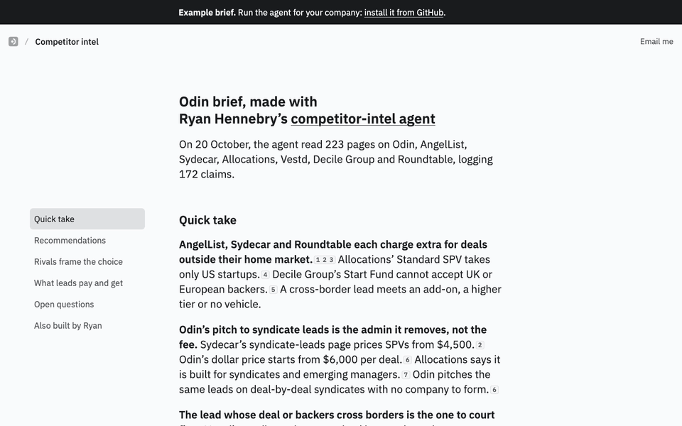

# Competitor Intel Agent

It researches a company and its rivals, and publishes a one-page brief where every finding cites the page it came from.

**Example output: [ryanhennebry.xyz/competitor-intel-agent](https://ryanhennebry.xyz/competitor-intel-agent/)**

[](https://ryanhennebry.xyz/competitor-intel-agent/)

## What the brief contains

- **Quick take**: three findings the company doesn't already know, each one sourced.
- **Recommendations**: what to do next quarter, each with a next step.
- **Where the money is moving**: what each rival changed recently, or what it has stayed quiet about.
- **How each teaches and sells**: a comparison table of terms, pricing and positioning, with an "unknown" wherever a rival's own site leaves the point open.
- **Open questions**: what the evidence couldn't settle.

Each claim carries a source chip. Hover or tap it to see the evidence and the page it came from. A page that blocked the fetch is labelled as blocked, never guessed at.

## How it works

A run is a graph of 69 nodes: 30 Claude Code subagents and 39 deterministic code steps. `tools/run.py` owns order, dispatch and the gates between nodes. Agents write typed data. Code checks it, and code renders the page. No agent writes HTML.

1. **Frame**: identify the company, build a model of the reader, and set the questions the brief must answer.
2. **Discover and select**: map the market, pick the rivals that matter most, and rank them.
3. **Extract**: fetch each company's own pages (`tools/fetch.py`, with a headless-Chrome fallback) and log every claim to a ledger with its URL, a verbatim quote and a state: verified, company-claimed, blocked or absent.
4. **Lock and shape**: commit to a thesis, then allocate the page's word budget to the findings that carry it.
5. **Author**: write the brief as JSON spans, each one citing ledger rows.
6. **Critique**: reader screeners plus red-team, truth and voice critics. An arbiter applies their fixes.
7. **Verify**: re-check every span against its cited rows. The verdict gate passes only when every span passes and every URL on the page appears in a retained snapshot.
8. **Render and publish**: `build/web.py` renders a self-contained page (subset fonts, inlined logos, its own share card). `tools/publish.py` deploys it and probes the live URL.

The rules that govern a run live in [`AGENTS.md`](AGENTS.md) and [`references/`](references/): the runbook, one file per stage, the provenance rules, the page contract and JSON schemas for every artefact. [`quality-bar/`](quality-bar/) holds the reader model, the voice card and the banned patterns that the critics enforce.

## Run it

This is a snapshot of a working personal tool, not a packaged product. It runs on macOS with Claude Code.

Requirements:
- [Claude Code](https://claude.com/claude-code), signed in. Each agent node runs as a `claude` subprocess.
- Python 3.13 (the version it was built on) and Google Chrome or Chromium.

```bash
python3 -m pip install -r requirements.txt
python3 -m playwright install chromium
```

```bash
bin/intel run https://example.com/a-page-naming-the-company --dry-run
```

`--dry-run` prints the node graph. Drop it to run. Runs land in `~/competitor-intel-runs/<company>-<date>/` (override with `INTEL_RUNS_DIR`), and the rendered page is `brief/web/index.html` inside that run. `bin/intel status` shows progress and `bin/intel cost` shows spend.

Notes:
- **Cost**: a full run makes many Opus calls. Expect tens of dollars of usage per brief.
- **Publishing**: the `publish` node is wired to the author's site and stops without its checkout. Everything before it runs, so open the local `index.html`.
- **MKT1**: the `mkt1` node calls a paid marketing-research service through MCP. It's optional and off the critical path, and the run continues without it.
- **Tests**: each tool has a `--selftest`. Their fixtures come from private runs and aren't published here.

## Licence

MIT. See [LICENSE](LICENSE).
